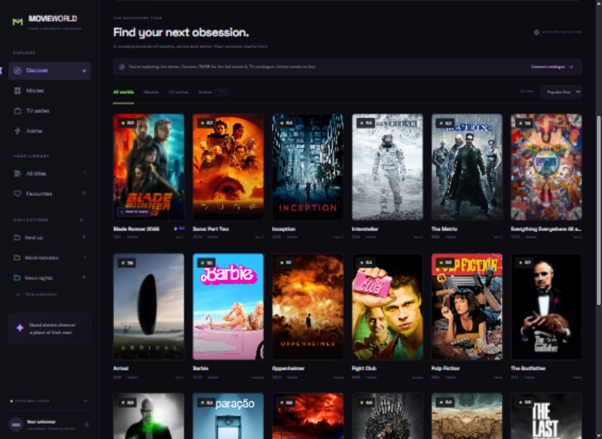

# Movie World

A personal movie, TV and anime discovery app with a cinematic cyberpunk interface. Built for desktop and mobile browsers with a small Node.js server, native ES modules and **zero runtime dependencies**.



## Run locally

Install [Node.js 22.9+](https://nodejs.org/), open a terminal in this repository, then:

```powershell
npm start
```

Open **http://127.0.0.1:3000**. No install step, build step, database or API key is required for the demo. `npm run dev` restarts the server when source files change; refresh the browser to pick up frontend changes.

## Features

- Search and browse movies, TV series and anime, with separate media tabs and provider pagination.
- Cinematic title details with synopsis, genres, cast, creator, runtime, seasons, episode totals and trailer links when supplied by the provider.
- Persistent favourites and watchlist.
- Create, rename and delete collections; a title can belong to multiple collections.
- Personal ratings in half-point increments from 0.5 to 10.
- Watch status: want to watch, watching, completed, on hold and dropped.
- Episode progress for series and anime, plus private notes.
- Filter the personal library by media type, watch status and title; sort by recently saved, your rating or title.
- JSON export and validated import with an explicit replacement confirmation.
- Keyboard navigation, native accessible dialogs, reduced-motion support and responsive layouts.
- Separate demo/live modes, actionable provider errors and image fallbacks.

## Enable the full catalogue

The app starts with 24 clearly labelled preview titles and bundled preview artwork. Demo metadata is an editorial snapshot, not current provider data. Live catalogue images require internet access; fallback artwork remains usable when images cannot load.

1. Create a [TMDB account and request API access](https://www.themoviedb.org/settings/api).
2. Copy `.env.example` to `.env` in the repository root:

   ```powershell
   Copy-Item .env.example .env
   ```

3. Put the **API Read Access Token** in `.env`:

   ```dotenv
   TMDB_READ_TOKEN=your_read_access_token
   ```

4. Restart the server. Open **Settings → Catalogue mode → Live**.

The app expects a TMDB **Bearer read token**, not the shorter v3 API key and not a user session ID. Never commit `.env`. The token is used only by the server and is never sent to the browser. No in-app account or TMDB user login is needed to save your personal library.

**Anime works without a key:** select Live in Settings, then browse the Anime tab. When no TMDB token is configured, switching to live automatically selects Anime. The combined All worlds live feed requires a TMDB token and searches TMDB and the anime provider. The movie/TV and anime catalogues may list the same anime separately; provider identities remain separate to prevent incorrect merges. Combined pages follow each provider’s own pagination and ranking. Sorting is available in individual browse tabs; search uses provider relevance.

## Data and privacy

The personal library is stored under `movie-world.library.v1` in **this browser’s localStorage**. It is not sent to TMDB or Jikan. There is no cloud sync, account backend or server-side user database in this MVP. A different browser, profile or origin (including changing ports) has a separate library. Export a JSON backup before clearing browser data or moving devices. Import replaces the current library after confirmation.

The app does not stream video. Trailers, when available, open on YouTube. Live artwork and Google Fonts are fetched from their respective providers, which receive normal browser requests. Demo artwork is bundled locally. Searches and title lookups go through the local server to TMDB/AniList/Jikan. The demo remains usable without a catalogue API connection, but this is not a fully offline PWA.

## APIs and licensing

| Provider | Purpose                                                            | Authentication                    | Documentation                                                                                                                                                                                                                           |
| -------- | ------------------------------------------------------------------ | --------------------------------- | --------------------------------------------------------------------------------------------------------------------------------------------------------------------------------------------------------------------------------------- |
| TMDB     | Movie / TV search, discovery, metadata, cast, trailers and artwork | Server-side API Read Access Token | [Application authentication](https://developer.themoviedb.org/docs/authentication-application), [multi-search](https://developer.themoviedb.org/reference/search-multi), [FAQ and licensing](https://developer.themoviedb.org/docs/faq) |
| AniList  | Primary anime search and metadata                                  | No API key                        | [Public API](https://docs.anilist.co/guide/auth/), [media queries](https://docs.anilist.co/guide/graphql/queries/media)                                                                                                                 |
| Jikan v4 | Fallback anime search and metadata from MyAnimeList                | No API key                        | [REST API documentation](https://docs.api.jikan.moe/), [Jikan](https://jikan.moe/)                                                                                                                                                      |

TMDB’s developer API is free for non-commercial use with attribution. Revenue-generating use requires discussing commercial licensing with TMDB. API access and availability are controlled by each provider; no catalogue guarantees coverage of every title ever made. Jikan is an unofficial MyAnimeList API and has rate limits. The server serialises AniList requests with a 2.1-second minimum interval, Jikan requests with a 400 ms minimum interval and caches successful responses for five minutes (maximum 300 entries). Upstream timeouts, rate limits and partial combined-provider outages are surfaced in the interface.

This product uses the TMDB API but is not endorsed or certified by TMDB. Movie and anime artwork belongs to its respective rights holders.

## Verification

```powershell
npm run check
npm test
```

The automated tests cover library persistence/backup round trips, title updates, collection lifecycle, filtering, import validation, provider normalization, demo search, authorization headers, cache reuse, upstream failure handling, and actual HTTP routes, validation, static files and security headers. Tests mock upstream catalogue services; live TMDB verification requires your read token.

## Structure

```text
public/            Browser UI, CSS, icons and manifest
public/js/app.js    View rendering, dialogs, routes and interactions
public/js/library.js  Pure library operations and backup validation
server/index.js    HTTP server, static assets, API routes and security headers
server/catalog.js  TMDB / AniList / Jikan adapters, cache and request scheduling
server/demo.js     Editorial preview catalogue
tests/             Node test runner tests
```

`HOST` defaults to `127.0.0.1`; `PORT` defaults to `3000`. A hosted Node deployment can set `HOST=0.0.0.0`, supply `TMDB_READ_TOKEN` through the host’s secret manager, and run `npm start`. This repository has no deployment-specific service dependency. Before opening a deployment to the public, add authentication or request quotas to protect the shared API token and provider limits. A next release can add a user database and optional cross-device sync without changing the catalogue provider interface.
